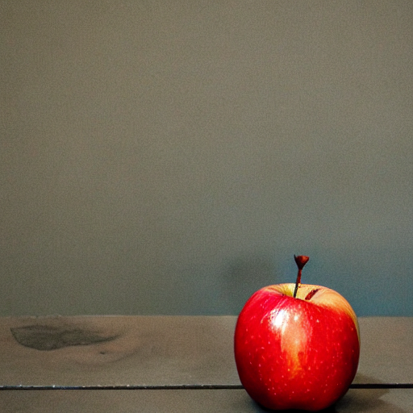
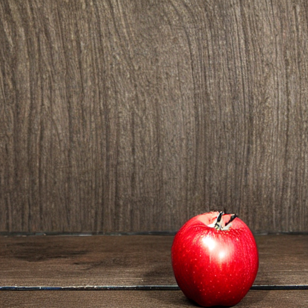
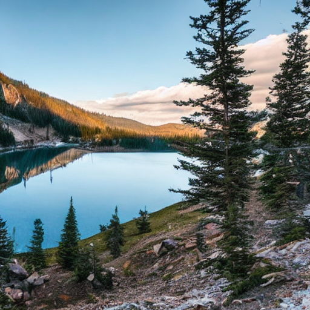
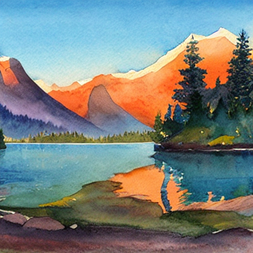
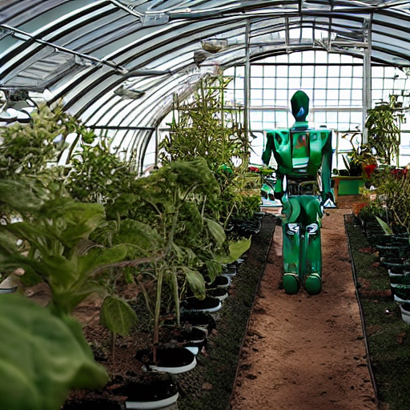
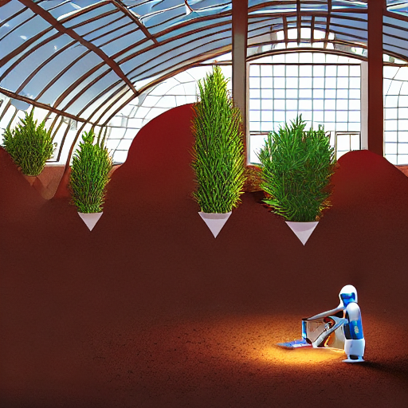

# Эксперименты со Stable Diffusion

Три темы: простой натюрморт, пейзаж и фантастическая сцена. Для каждой
подготовлены исходный и уточнённый промпты в `prompts.json`.

Применяются уточнение объекта и окружения, указание визуального стиля,
освещения и композиции, а также negative prompt. Внутри пары сохраняются
одинаковые seed, модель, размер изображения и параметры генерации.
Изменяются одновременно описание и negative prompt; это сравнение двух
вариантов запроса, а не измерение вклада каждой отдельной техники.

## Запуск

Нужен Python 3.10. Команды выполняются из папки проекта:

```bash
python -m venv .venv
.venv/bin/python -m pip install -r requirements.txt
.venv/bin/python -m pip check
.venv/bin/python generate_images.py --device mps --steps 20
```

Для CPU используйте `--device cpu`. При первом запуске модель скачивается
в локальную `.cache/huggingface`; требуется сеть и несколько гигабайт места.
Ключ API не требуется. Генерация выполняется локально, без загрузки
изображений во внешний сервис. На разных устройствах одинаковый seed
не гарантирует побитового совпадения результатов.

## Состояние

04.11.2026 локально сгенерированы и визуально проверены шесть изображений.
Модель: Stable Diffusion 1.5; MPS, float32, 512×512, 20 шагов,
guidance scale 7.5, PNDMScheduler. Внутри каждой пары seed одинаковый.
Параметры каждого запуска находятся в `results/generation.json`, версии
библиотек — в `results/environment.json`.

## Изученные техники

- [Prompt techniques — Diffusers 0.30.3](https://huggingface.co/docs/diffusers/v0.30.3/using-diffusers/weighted_prompts): конкретный объект, вид изображения, освещение и детали.
- [Reproducible pipelines](https://huggingface.co/docs/diffusers/v0.30.3/using-diffusers/reusing_seeds): управление случайностью для сравнения.
- [Text-to-image](https://huggingface.co/docs/diffusers/v0.30.3/using-diffusers/conditional_image_generation): параметры генерации и negative prompt.

## Натюрморт, простой запрос

Исходный промпт:

> A red apple on a table



Уточнённый промпт:

> Studio photograph of a single red apple on a dark wooden table, soft window lighting from the left, close-up, simple background, sharp focus

Negative prompt: `blurry, low quality, text, watermark`.



Оба изображения показывают красное яблоко на столе. В уточнённом варианте появились выраженные деревянные фон и поверхность. При этом крупный план и свет слева не выполнены явно; у яблока заметна странная форма черенка. Полного улучшения всех деталей не произошло.

## Пейзаж, запрос средней сложности

Исходный промпт:

> A mountain lake with a cabin



Уточнённый промпт:

> Watercolor painting of a small wooden cabin beside a calm alpine lake, snow-capped mountains in the background, warm sunrise, reflections in the water, wide landscape composition

Negative prompt: `blurry, low quality, text, watermark`.



Исходный вариант похож на фотографию озера с хвойными деревьями. Уточнение изменило стиль на акварель, добавило тёплые горы и отражения. Домик не появился в обоих вариантах. Уточнение помогло управлять стилем, но не обеспечило наличие каждого объекта.

## Фантастическая сцена, сложный запрос

Исходный промпт:

> A robot gardener in a greenhouse on Mars



Уточнённый промпт:

> Digital illustration of a friendly small robot tending green plants inside a glass greenhouse on Mars, red desert visible outside, warm interior light, wide-angle view, detailed science fiction concept art

Negative prompt: `blurry, low quality, text, watermark`.



В исходном варианте видны робот и растения в теплице, но Марс не узнаётся. Уточнение добавило красный грунт и небольшого робота в иллюстративном стиле. Однако растения выглядят подвешенными, а геометрия сцены неправдоподобна. Марсианское окружение и уход за растениями выполнены лишь частично.

## Выводы

Указание стиля и окружения заметно меняет результат, но длинный промпт
не гарантирует точного выполнения всех условий. Самый цельный результат
серии — акварельный пейзаж. Самый необычный — робот в красной теплице
с неправдоподобно расположенными растениями. Для дальнейшего улучшения
стоит упростить сложную сцену и проверять изменения по одному.

Изображения и описания подготовлены локально. Публикация в общем чате
и прикрепление результатов на учебной платформе не выполнялись.
